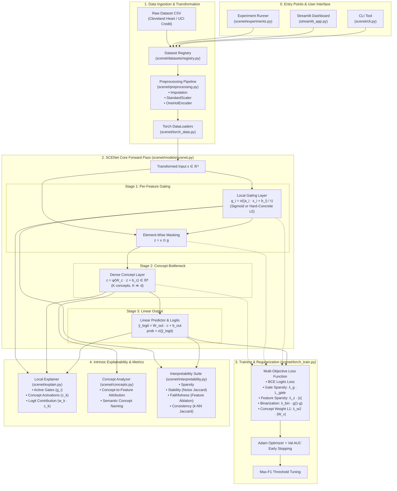

# SCENet Architecture & System Execution Guide

**SCENet** (**S**tructured **C**oncept-**E**mbedded **Net**work) is an intrinsically explainable deep learning framework designed for high-stakes tabular decision systems (e.g., credit risk assessment and clinical diagnostics). Unlike post-hoc explanation methods (such as SHAP or LIME) that compute local linear or perturbation approximations around black-box models, SCENet achieves **intrinsic interpretability** by architectural design. Every prediction is accompanied by an exact, mathematically verifiable decomposition across feature, concept, and decision tiers.

---

## 1. Architectural & Data Flow Map



---

## 2. Core Components Breakdown

| Component | Repository Path | Primary Responsibility |
|---|---|---|
| **Entry Points** | [`scenet/cli.py`](file:///d:/Projects/SCENet/scenet/cli.py)<br/>[`streamlit_app.py`](file:///d:/Projects/SCENet/streamlit_app.py)<br/>[`scenet/experiments.py`](file:///d:/Projects/SCENet/scenet/experiments.py) | Provides unified CLI subcommands (`train-scenet`, `explain-scenet`, `run-all`), interactive exploration dashboard, and cross-validation runners. |
| **Dataset Ingestion** | [`scenet/datasets/registry.py`](file:///d:/Projects/SCENet/scenet/datasets/registry.py) | Central registry mapping dataset identifiers (`heart_disease`, `credit_default`, `german_credit`) to canonical schemas, column roles, and target variables. |
| **Preprocessing** | [`scenet/preprocessing.py`](file:///d:/Projects/SCENet/scenet/preprocessing.py)<br/>[`scenet/pipeline.py`](file:///d:/Projects/SCENet/scenet/pipeline.py) | Performs stratified train/val/test splits, numerical median imputation, standard scaling, and categorical one-hot encoding via scikit-learn `ColumnTransformer`. |
| **Batching & Tensors** | [`scenet/torch_data.py`](file:///d:/Projects/SCENet/scenet/torch_data.py) | Converts transformed NumPy arrays into PyTorch `TensorDataset` and `DataLoader` instances with configurable batch sizes and worker threads. |
| **Model Architecture** | [`scenet/models/scenet.py`](file:///d:/Projects/SCENet/scenet/models/scenet.py) | Implements the 3-stage PyTorch model: per-feature local gating ($g$), concept bottleneck projection ($c$), and the transparent linear classification head ($W_{\text{out}}$). |
| **Training Engine** | [`scenet/torch_train.py`](file:///d:/Projects/SCENet/scenet/torch_train.py) | Executes mini-batch gradient descent with multi-objective regularization (gate sparsity, binary entropy, concept weight L1), validation AUC early stopping, and optimal F1 threshold selection. |
| **Local Explainer** | [`scenet/explain.py`](file:///d:/Projects/SCENet/scenet/explain.py) | Generates instance-level hierarchical explanations decomposing decisions into feature gate activations, concept activations, and direct additive contributions to the output logit. |
| **Global Concept Analyzer**| [`scenet/concepts.py`](file:///d:/Projects/SCENet/scenet/concepts.py) | Analyzes learned concept matrices across the entire population, mapping high-level concepts back to natural feature groups and assigning semantic descriptors. |
| **Interpretability Suite**| [`scenet/interpretability.py`](file:///d:/Projects/SCENet/scenet/interpretability.py) | Evaluates quantitative explainability metrics: Sparsity, Perturbation Stability, Counterfactual Faithfulness, and Local Consistency. |

---

## 3. Step-by-Step Execution Walkthrough

### Step 1: Ingestion & Pipeline Orchestration
* **Visual Anchor:** `[0. Entry Points & User Interface]` $\rightarrow$ `[1. Data Ingestion & Transformation]`
* **Code Reference:** [`scenet/cli.py`](file:///d:/Projects/SCENet/scenet/cli.py), [`streamlit_app.py`](file:///d:/Projects/SCENet/streamlit_app.py), [`scenet/pipeline.py`](file:///d:/Projects/SCENet/scenet/pipeline.py)

1. The process initiates from the CLI (`python -m scenet ...`), an automated experiment orchestrator (`run-multiseed` / `run-kfold`), or the Streamlit web interface.
2. The dataset configuration is retrieved via `load_dataset()` from [`scenet/datasets/registry.py`](file:///d:/Projects/SCENet/scenet/datasets/registry.py).
3. `prepare_data()` in [`scenet/preprocessing.py`](file:///d:/Projects/SCENet/scenet/preprocessing.py) performs a stratified train/validation/test split. It fits a `ColumnTransformer` exclusively on the training split to prevent data leakage:
   * Continuous variables: SimpleImputer (median) followed by `StandardScaler`.
   * Categorical variables: SimpleImputer (most frequent) followed by `OneHotEncoder(handle_unknown="ignore")`.
4. Transformed arrays are converted into PyTorch loaders by `make_dataloaders()` in [`scenet/torch_data.py`](file:///d:/Projects/SCENet/scenet/torch_data.py).

---

### Step 2: The Core SCENet Forward Pass
* **Visual Anchor:** `[2. SCENet Core Forward Pass]` (`Stage 1` $\rightarrow$ `Stage 2` $\rightarrow$ `Stage 3`)
* **Code Reference:** [`SCENet.forward()`](file:///d:/Projects/SCENet/scenet/models/scenet.py#L85-L106) in [`scenet/models/scenet.py`](file:///d:/Projects/SCENet/scenet/models/scenet.py)

For each transformed input batch $x \in \mathbb{R}^{B \times d}$, the model evaluates:

#### 1. Stage 1: Per-Feature Local Gating (`GATES` & `MASK`)
$$g_i = \sigma\left(\frac{a_i \cdot x_i + b_i}{\tau}\right)$$
* SCENet learns instance-adaptive gating weights (`gate_scale` $a$ and `gate_bias` $b$).
* **Alternative:** Stochastic **Hard-Concrete $L_0$ gates** (Louizos et al.) can be sampled during training to achieve true exact-zero feature silencing:
  $$\bar{s} = s \cdot (\zeta - \gamma) + \gamma, \quad g = \text{clamp}(\bar{s}, 0, 1)$$
* The input vector is masked via element-wise multiplication:
  $$z = x \odot g$$
  Features whose gate value evaluates to 0 are completely filtered out from propagating further.

#### 2. Stage 2: Concept Bottleneck (`BOTTLENECK`)
$$c = \phi(W_c \cdot z + b_c) \in \mathbb{R}^K \quad (K \ll d)$$
* The masked feature representation $z$ is projected into a low-dimensional bottleneck ($K$ concepts, typically 8 to 16) with a non-linear activation $\phi$ (ReLU, Tanh, or Sigmoid).
* This compresses hundreds of raw/one-hot features into high-level semantic abstractions.

#### 3. Stage 3: Linear Output Layer (`LIN`)
$$\hat{y}_{\text{logit}} = W_{\text{out}} \cdot c + b_{\text{out}}, \quad p = \sigma(\hat{y}_{\text{logit}})$$
* A transparent linear mapping connects the concept representations directly to the output logit.
* **Core Invariant:** Because no further non-linearities exist after the concept layer, the contribution of concept $k$ to the logit is strictly additive: $\Delta \text{logit}_k = W_{\text{out}, k} \cdot c_k$.

---

### Step 3: Multi-Objective Regularization & Optimization
* **Visual Anchor:** `[3. Training & Regularization]`
* **Code Reference:** [`train_scenet()`](file:///d:/Projects/SCENet/scenet/torch_train.py#L59-L158) in [`scenet/torch_train.py`](file:///d:/Projects/SCENet/scenet/torch_train.py)

To ensure the learned representations remain sparse, stable, and interpretable, SCENet optimizes a composite objective:
$$\mathcal{L} = \mathcal{L}_{\text{BCE}}(\hat{y}_{\text{logit}}, y) + \lambda_g \mathcal{L}_{\text{gate}} + \lambda_z \|z\|_1 + \lambda_{\text{bin}} \sum_{i=1}^d g_i(1 - g_i) + \lambda_{w_2} \|W_c\|_1$$

* **$\mathcal{L}_{\text{BCE}}$:** Binary Cross Entropy with Logits loss ensuring high predictive accuracy.
* **$\lambda_g \mathcal{L}_{\text{gate}}$:** Enforces sparsity over the feature gates ($L_1$ penalty on sigmoid outputs, or expected $L_0$ active probability for Hard-Concrete gates).
* **$\lambda_z \|z\|_1$:** Penalizes the magnitude of selected inputs, encouraging reliance on fewer active signals.
* **$\lambda_{\text{bin}} g_i(1 - g_i)$:** Binarization penalty driving continuous gate activations away from ambiguous intermediate values ($\approx 0.5$) toward decisive binary states ($0$ or $1$).
* **$\lambda_{w_2} \|W_c\|_1$:** Enforces sparsity on concept projection weights, ensuring individual concepts depend on small, focused subsets of features.
* **Optimization & Early Stopping:** The network is trained with the Adam optimizer. Model checkpoints are preserved based on validation set **AUC-ROC** to safeguard against class imbalance.
* **Threshold Tuning:** After convergence, [`select_threshold_max_f1()`](file:///d:/Projects/SCENet/scenet/metrics.py#L64) tunes the classification probability threshold on the validation split to optimize the final test $F_1$-score.

---

### Step 4: Hierarchical Explanation Decomposition
* **Visual Anchor:** `[4. Intrinsic Explainability & Metrics]` $\rightarrow$ `EXPL`
* **Code Reference:** [`explain_single()`](file:///d:/Projects/SCENet/scenet/explain.py#L25-L147) in [`scenet/explain.py`](file:///d:/Projects/SCENet/scenet/explain.py)

When querying an individual instance $x$, SCENet generates an exact three-level explanation:

```
Level 1: Feature Gates
└── Gate Activation: g_i ∈ [0, 1]
└── Selected Feature Magnitude: |z_i| = |x_i · g_i|
└── Original Feature Group Aggregation: ∑_{i ∈ group} |z_i|

Level 2: Concept-to-Feature Attribution
└── Concept Activation: c_k = φ(W_{c, k} · z + b_{c, k})
└── Per-Feature Contribution to Concept k: W_{c, ki} · z_i

Level 3: Decision Logit Decomposition
└── Logit Contribution: Δlogit_k = W_{out, k} · c_k
└── Direction: Positive (pushes toward class 1) vs Negative (pushes toward class 0)
```

---

### Step 5: Global Concept Analysis & Interpretability Benchmarking
* **Visual Anchor:** `[4. Intrinsic Explainability & Metrics]` $\rightarrow$ `CONC` & `METRICS`
* **Code Reference:** [`scenet/concepts.py`](file:///d:/Projects/SCENet/scenet/concepts.py), [`scenet/interpretability.py`](file:///d:/Projects/SCENet/scenet/interpretability.py)

1. **Global Concept Summarization (`CONC`):**
   * Computes mean absolute activation per concept across the dataset: $\frac{1}{N} \sum_{n=1}^N |c_k^{(n)}|$.
   * Identifies top contributing input features and groups for each concept by examining the row vectors of $W_c$.
   * Translates abstract neural representations into human-understandable domain concepts (e.g., Concept 3 represents "Short-Term Repayment Delinquency").

2. **Quantitative Interpretability Suite (`METRICS`):**
   * **Sparsity:** Measures average active feature count per decision where $g_i \ge 0.5$.
   * **Stability:** Calculates Jaccard similarity of selected top-$k$ features when inputs are perturbed with small Gaussian noise ($\sigma = 0.05$).
   * **Faithfulness:** Quantifies the degradation in model accuracy/AUC when the top-$k$ selected features are removed or zeroed out.
   * **Consistency:** Evaluates the Jaccard similarity of selected features between nearest neighbors in feature space.
